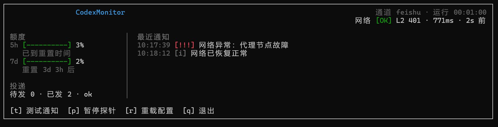

# CodexMonitor

**在 VSCode 里用 Codex 跑任务时，不用一直盯着屏幕。**

后台常驻，监控本地 Codex 的运行状态，通过飞书（或本地控制台）把任务完成、额度告警、网络故障推给你。

> 当前版本仅支持 **飞书** 与 **控制台** 两种通道；微信 iLink 暂不兼容。

[](https://nodejs.org/)
[](https://www.typescriptlang.org/)
[](https://github.com/yyy-router/CodexMonitor/actions/workflows/ci.yml)
[](https://github.com/yyy-router/CodexMonitor/actions/workflows/build-exe.yml)
[](#许可)
[](#已知限制)
[](#)

---



## 功能

| | 场景 | 级别 |
|---|---|---|
| ✅ | **任务完成** —— 按项目聚合，带摘要（受 `aggregate` 节流） | `info` |
| 🚨 | **任务被中断** —— 立即推送 | `alert` |
| 📊 | **额度告警** —— 80%（默认关）/ 95% / 耗尽 100% | `warn` / `critical` / `alert` |
| 🔄 | **额度重置** —— 5 小时 / 7 天窗口 | `info` |
| 📶 | **网络异常** —— 代理未运行 / 代理节点故障 / 整体断网 | `alert` |
| ✅ | **网络恢复** —— 连续 2 次探测正常 | `info` |

## 当前状态

- ✅ **可运行**：`npm start` 启动常驻进程（Node ≥ 26）
- ✅ **推送通道**：飞书企业自建应用、控制台；**iLink 暂不实现**（`channel: "ilink"` 会明确报错）
- ✅ **单文件打包**：`npm run build:exe` 产出 `dist-exe/CodexMonitor.exe`（Node SEA，约 105 MB）
- ⚠️ **运行时依赖**：Ink / React / ascii.rest（TUI 与启动动画）；分发以单文件 exe 为准
- ✅ **投递可靠**：失败自动进入发件箱，指数退避重试并跨重启恢复
- ⚠️ **不回放历史**：从进程启动时刻开始 tail 会话日志，启动前的旧事件不会补推

## 快速开始

需要 Node.js ≥ 26（仓库内有 `.nvmrc`，可 `nvm use`）。

```bash
npm install
cp codexmonitor.config.example.json codexmonitor.config.json
# 编辑 codexmonitor.config.json：先设 "channel": "console" 本地验证
npm start
```

启动后会看到：

```
[codexmonitor] 已启动（通道：console）
```

用 Codex 跑任务：**中断会立即推送**；**任务完成按 `aggregate` 节流聚合**（默认最多 2 小时一条）。想先验证链路，中断一个任务最快。

### 切换到飞书

1. 在 **[飞书开放平台 · 开发者后台](https://open.feishu.cn/app)** 创建**企业自建应用**，并开通「机器人」能力（[机器人能力说明](https://open.feishu.cn/document/uAjLw4CM/ukTMukTMukTM/bot-v3/bot-overview)）
2. 在「凭证与基础信息」页获取 `App ID` / `App Secret`
3. 在「权限管理」中开通发送单聊消息、通过邮箱/手机号查询用户所需的权限，并发布应用版本
4. 把 `notify.channel` 改为 `"feishu"`，填写 `feishu.appId`、`feishu.appSecret`
5. 填写 `feishu.email` 或 `feishu.mobile`（用于解析 open_id，邮箱优先）；该用户需在应用可用范围内

> 参考：[开放平台控制台](https://open.feishu.cn/app) · [机器人能力说明](https://open.feishu.cn/document/uAjLw4CM/ukTMukTMukTM/bot-v3/bot-overview) · [开发者文档](https://open.feishu.cn/document/home/index)

```json
{
  "notify": { "channel": "feishu" },
  "feishu": {
    "appId": "cli_xxxxxxxx",
    "appSecret": "xxxxxxxx",
    "email": "you@corp.com",
    "mobile": ""
  }
}
```

> `codexmonitor.config.json` 含密钥，已被 `.gitignore` 忽略，**不要提交**。

## 配置

配置文件为单一 JSON，深合并到默认值；只需写要覆盖的字段。

| 字段 | 默认值 | 说明 |
|---|---|---|
| `notify.channel` | `"ilink"` | `feishu` / `console`；默认值 `ilink` 未实现，**必须显式设置** |
| `codex.sessionsDir` | `~/.codex/sessions` | Codex 会话日志根目录 |
| `codex.maxTrackedFiles` | `20` | 同时跟踪的最新会话文件数 |
| `notify.aggregate.minIntervalMs` | `7200000` | 完成通知的最小间隔（2h） |
| `notify.aggregate.maxItems` | `5` | 单条聚合消息最多包含的任务数 |
| `notify.aggregate.maxPerDay` | `4` | 完成通知每日上限 |
| `notify.thresholds.warnEnabled` | `false` | 是否推送 80% 预警 |
| `probe.enabled` | `true` | 是否启用网络探针 |
| `probe.intervalMs` | `15000` | 正常探测周期 |
| `probe.retryDelayMs` | `3000` | 故障未确认时的快速重试间隔 |
| `probe.timeoutMs` | `3000` | 单层探测超时 |
| `probe.confirmAttempts` / `recoverAttempts` | `2` / `2` | 连续几次故障才报警 / 连续几次正常才恢复 |
| `probe.targets.l2` | `https://api.openai.com/v1/responses` | 经代理探测的 Codex 真实端点 |
| `probe.proxy.mode` | `"auto"` | `auto` 读环境变量与系统代理；`manual` 只探测 `ports` |
| `state.dir` | `~/.codexmonitor` | 运行时状态目录 |

## 工作原理

```
Watcher（只读 JSONL） ─┐
                       ├─▶ PolicyEngine（纯函数） ─▶ Notifier ─▶ 飞书 / 控制台
NetProbe（独立定时）   ─┘                              │
                                                       └─▶ 投递日志
```

| 层 | 职责 |
|---|---|
| **Watcher** | 增量 tail `rollout-*.jsonl`，解析完成 / 中断 / 额度事件，按 `ts` 排序 |
| **NetProbe** | 代理端口推导 → L1 TCP / L2 经代理访问 Codex 端点 / L3 直连（辅助）→ 滞回状态机 |
| **PolicyEngine** | 分级、聚合节流、额度状态机、配额守卫。纯函数，无 IO |
| **Notifier** | 分片投递、发件箱重试、投递留痕。通道可替换 |

**探针判定**：`L2` 返回 401/2xx 视为通；403（Cloudflare 拦截）、5xx、超时视为不通。代理模式下 `L1 ok + L2 失败` 一律判「代理节点故障」——TUN 模式下直连也走隧道，不能据此判断是否整体断网。

## 运行时产物

| 路径 | 内容 |
|---|---|
| `~/.codexmonitor/delivery.jsonl` | 每次投递一条：级别、来源、正文、`ok`、错误码、messageId |
| `~/.codexmonitor/quota.json` | 额度状态快照，重启后恢复 |
| `~/.codexmonitor/pending.json` | 投递失败、等待重试的通知 |

## 开发

```bash
npm run typecheck   # tsc --noEmit
npm test            # vitest run
npm run build       # 编译到 dist/
npm start           # prestart 自动 build，然后常驻运行
npm run build:exe   # Node 26 SEA：dist-exe/CodexMonitor.exe
```

测试覆盖：JSONL 解析、尾部读取、分级、聚合、额度状态机、配额守卫、代理推导（含 SOCKS5 / 认证 / HTTPS）、三层探测、投递分片、投递日志、状态持久化、编排层、端到端文件链路、运行时事件与监控核心、TUI 格式化 / store / 组件。

## 自动化

| 工作流 | 触发 | 内容 |
|---|---|---|
| `ci.yml` | PR、push `main` | windows-latest：`npm ci` → typecheck → build → test |
| `build-exe.yml` | 手动、`v*` 标签 | `npm run build:exe` → 上传 `CodexMonitor.exe`；标签构建自动创建 Release |

打包需要 Node 26（`mainFormat: "module"` 的 SEA 能力），仓库 `.nvmrc` 已固定版本。未签名 exe 首次运行会触发 SmartScreen；如需签名，必须在 postject 注入**之后**进行。

## 已知限制

- **平台**：目前仅在 **Windows** 上验证与支持；macOS / Linux 未验证（代理推导依赖 Windows 注册表，其他平台只能走环境变量）
- **iLink 通道未实现**：本轮不兼容，`channel: "ilink"` 直接报错
- **冷启动不回放**：启动前的历史事件不补推；额度状态依赖 `quota.json`，首次运行要等 Codex 下一次 `token_count`
- **Windows 的 SIGTERM**：父进程 `kill()` 会直接终止进程，`SIGTERM` 处理器不执行；交互式 `Ctrl+C` 正常
- **`quotaWarn` 尚无冷却**：`quotaWarnCooldownMs` 已声明但未生效，开启 80% 预警后可能偏频繁

## 许可

ISC
